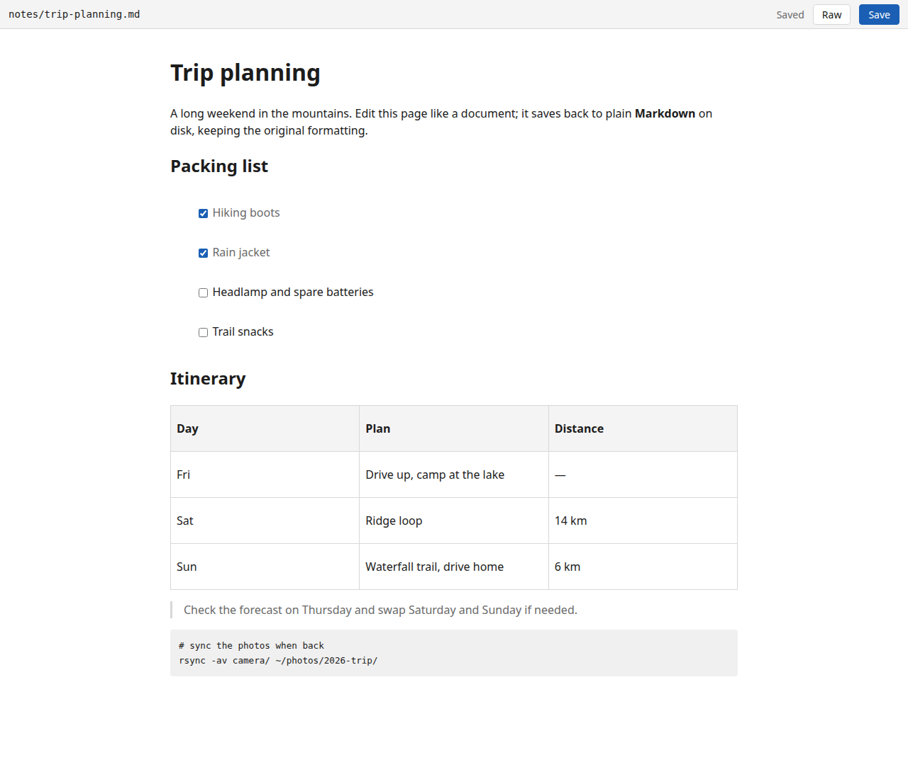
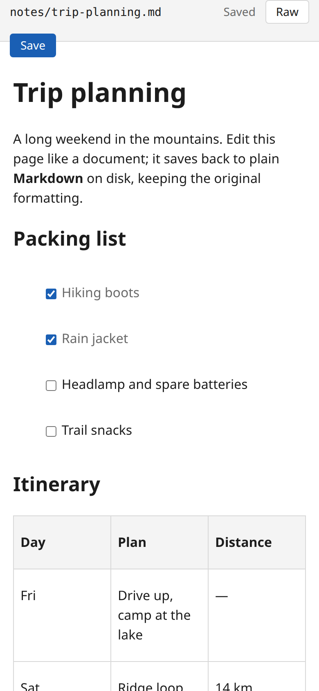

# mdedit

A single Go binary that edits Markdown files in the browser (WYSIWYG via
Milkdown, with a raw-text fallback) against directories that already exist on
disk, for example the ones a Caddy `file_server` serves read-only. No file
browser, no uploads, no git: your file host is the browser, mdedit is only the
editor.

  
  

## Security posture

- **No authentication.** Run it either as its own Tailscale node
  (`--tsnet-hostname`, HTTPS with Tailscale certs, reachable only from your
  tailnet) or bound to localhost (`--listen 127.0.0.1:8585`, the default). Do
  not expose it any other way.
- Every request's `Host` header must match the listen host, `localhost`,
  `127.0.0.1`, `::1`, the tsnet node's name/FQDN, or an `--allowed-host`
  (DNS-rebinding defence).
- Writes require the custom header `X-Mdedit: 1`, and `Origin` /
  `Sec-Fetch-Site` must be same-origin when present. mdedit never answers CORS
  preflights, so other origins cannot write.
- Paths are confined to the configured roots: no `..`, no `.git`, symlinks must
  resolve inside the root. Only files whose extension is in `--ext` can be read
  or written; `/img/` serves only files that sniff as `image/*`.
- Strict CSP on the HTML pages, `nosniff`, `no-referrer`, `no-store`.
- Writes are conditional on the file's SHA-256 (409 on conflict), atomic
  (temp file + rename), and preserve BOM, CRLF and trailing-newline
  conventions and mode bits.

## Flags

| flag | default | meaning |
| --- | --- | --- |
| `--root NAME=DIR` | required, repeatable | Expose DIR under URL prefix NAME (`[A-Za-z0-9_-]+`). |
| `--listen ADDR` | `127.0.0.1:8585` | Plain HTTP listener. Ignored with `--tsnet-hostname`. |
| `--tsnet-hostname NAME` | off | Run as Tailscale node NAME, HTTPS on :443. Login URL is logged on first run; `TS_AUTHKEY` is honoured. |
| `--tsnet-dir DIR` | `$XDG_STATE_HOME/mdedit/tsnet` or `~/.local/state/mdedit/tsnet` | tsnet state. |
| `--allowed-host HOST` | repeatable | Extra `Host` values to accept. |
| `--view-base URL` | empty | Editor shows a "view" link to `URL/<path>`. |
| `--ext LIST` | `.md,.markdown` | Editable extensions, case-insensitive. |
| `--max-bytes N` | 10485760 | Max file and request body size. |
| `--max-image-bytes N` | 20971520 | Max size served by `/img/`. |

URLs: `/edit/NAME/rel/path.md` is the editor; `/api/file` is the JSON
read/write API; `/img/NAME/rel/pic.png` serves images referenced from
Markdown; `/` lists the root names.

## Build and run

Requires Go 1.26. Built frontend assets are committed under
`internal/web/static/`, so `go build` (or `go install`) needs no Node.

    make build                       # -> bin/mdedit
    bin/mdedit --root notes=~/notes  # http://127.0.0.1:8585/edit/notes/README.md

Rebuilding the frontend needs Node: `make web` (runs `npm ci && npm run build`
in `web/`). `make test` runs the Go tests and, if `web/node_modules` exists,
the TypeScript typecheck. `make all` builds both.

### systemd user service

`make install` builds the binary, symlinks it to `~/.local/bin/mdedit`,
symlinks `deploy/mdedit.service` into `~/.config/systemd/user/`, reloads, and
enables it. The checkout can live anywhere; after `git pull && make install`,
`systemctl --user restart mdedit` picks up the new build. The unit reads
`MDEDIT_FLAGS` from `~/.config/mdedit/env`; copy `examples/env.example` there
and edit it before the first install.

### Caddy integration

`examples/Caddyfile.snippet` and `examples/browse.html` show how to add an
"edit" link next to each `.md` entry in a Caddy `file_server browse` listing,
pointing at `https://<node>/edit/<root>/<path>`.

## License

MIT, see `LICENSE`.
